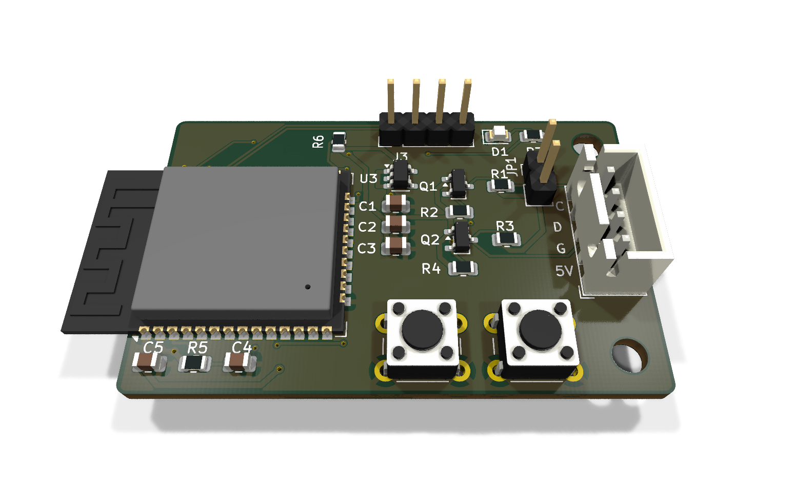
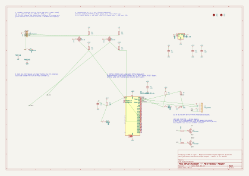
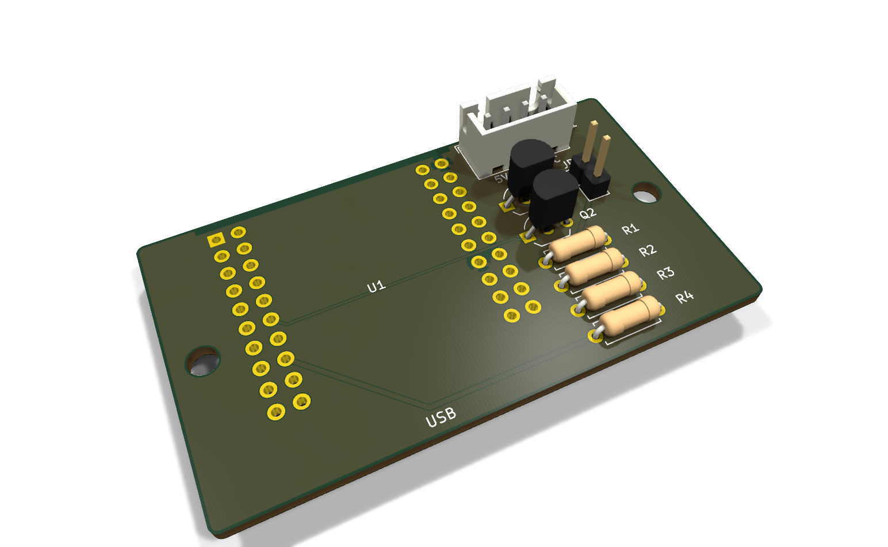
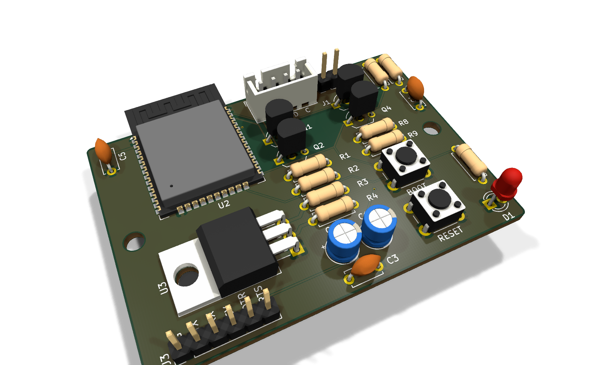
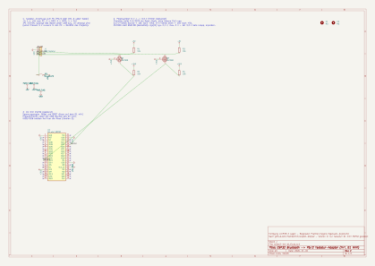
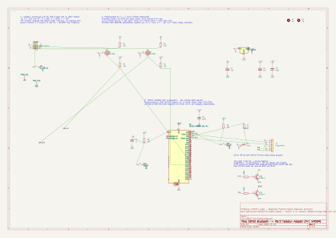

# Hardware: carrier boards for esp32-bt2ps2

> ⚠️ **Untested.** These boards have been designed and checked (KiCad ERC/DRC clean), but **no board has been
> manufactured or tested yet**. Use at your own risk and check everything with a multimeter before connecting
> it to a computer. Feedback welcome.
>
> ⚠️ **Noch nicht getestet.** Die Platinen sind entworfen und geprüft (ERC/DRC ohne Befund), aber **noch nicht
> gefertigt und nicht erprobt.**

Boards for the firmware in this repository — **keyboard only (version 1)**, same pins as the firmware
defaults (`KB_CLK_PIN = 22`, `KB_DATA_PIN = 23`), so the firmware runs unchanged.

| | [SMD](bt2ps2-smd) | [THT D1 mini](bt2ps2-tht-d1) | [THT WROOM](bt2ps2-tht-wroom) |
|---|---|---|---|
| ESP32 | ESP32-WROOM-32E soldered on | D1 mini ESP32 plugged in | ESP32-WROOM-32E soldered on |
| Level shifter 5 V ↔ 3.3 V | 2 × BSS138 (SOT-23) + 10 kΩ | 2 × 2N7000 (TO-92) + 10 kΩ | 2 × 2N7000 (TO-92) + 10 kΩ |
| 3.3 V regulator | AP2112K-3.3 | on the D1 mini | LD1117V33, TO-220 lying flat |
| Programming | J3 with auto-reset | USB of the D1 mini | J3 with auto-reset (2 × BC547) |
| Passives | 0805 | through-hole | through-hole (the WROOM is the only SMD part) |
| Size | 49.0 × 31.0 mm | 60.0 × 34.2 mm | 63.0 × 44.0 mm |

The old combined THT board (V1: D1 mini **or** WROOM on one 83 × 34 mm board) stays in [`bt2ps2-tht`](bt2ps2-tht)
for reference; since 2026-11-01 it is split into the two boards above.

Both are 2-layer boards made for JLCPCB's standard process (1.6 mm, 1 oz, HASL). Designed with **KiCad 10**.

**Downloads:** Gerber ZIPs, KiCad projects and schematics are attached to the
[release v0.1](https://github.com/sfambach/esp32-bt2ps2/releases/tag/v0.1).

## SMD board

> **V2 (2026-10-31):** the D1 mini socket is gone, the WROOM is rotated 90° (antenna over the left edge), all parts
> are on the front and the board shrank from 61 × 34 mm to 49 × 31 mm. Routed with Freerouting (45° traces, no traces
> under the module on the top layer), DRC clean. **Not manufactured yet.** V1 is in git history and release v0.1.

## THT boards

> **2026-11-01:** the combined THT board is split in two. **D1 mini:** socket, level shifter, J1/JP1, nothing else
> (regulator, reset and BOOT are on the D1 mini). **WROOM:** the LD1117V33 lies flat (TO-220 horizontal, about 4.5 mm
> high instead of 15 mm) and J3 has 6 pins with auto-reset as on the SMD board. Both routed with Freerouting, DRC clean,
> two M3 holes on the long axis. **Not manufactured yet.**

| D1 mini | WROOM |
|---|---|
|  |  |
|  |  |

## Enclosures

3D-printable cases for both boards (shell + lid, OpenSCAD source and STLs) are in [`case/`](case/README.md).

## What is on the board

- **J1 – keyboard connector to the PC** (JST-XH, 4 pins): `1 = +5V`, `2 = GND`, `3 = DATA`, `4 = CLK` (printed as
  `5V G D C`). Crimp a cable to a PS/2 (Mini-DIN-6) or AT (DIN-5) plug:

  | J1 | PS/2 Mini-DIN-6 pin | AT DIN-5 pin |
  |---|---|---|
  | 1 +5V | 4 | 5 |
  | 2 GND | 3 | 4 |
  | 3 DATA | 1 | 2 |
  | 4 CLK | 5 | 1 |

  Pinouts as commonly documented — **measure your plug before use.**
- **JP1 – 5 V from the PC.** Pull the jumper while the board is powered over USB (or J3), otherwise 5 V is fed back
  into the PC's keyboard port — the same warning as in the main README.
- **THT D1 mini board:** a *D1 mini ESP32* (MH-ET LIVE MiniKit / "D1 mini ESP32 ESP-WROOM-32", 4 rows of pins,
  39 × 32 mm) on female headers. Programming via its own USB port. Its USB end is flush with the board edge,
  its antenna overhangs the opposite edge.
- **SMD board / THT WROOM board:** an ESP32-WROOM-32E soldered on, antenna over the board edge. Adds the
  3.3 V regulator, EN/BOOT circuitry, **BOOT** and **RESET** buttons, a status LED on IO2 and **J3** for a
  USB-serial adapter: `1 GND`, `2 ESP TXD → adapter RX`, `3 ESP RXD → adapter TX`, `4 +5V`.
  `5 DTR` and `6 RTS` drive the usual two-transistor auto-reset (Q3/Q4, R8/R9, as on the ESP32-DevKitC; SMD
  MMBT3904, THT BC547): an adapter that brings out DTR and RTS flashes without pressing BOOT/RESET. A 4-wire adapter
  on pins 1–4 still works, then hold BOOT, tap RESET, release BOOT. (The old combined THT board has a 4-pin J3.)
- IO25/IO26 are kept free for the mouse port (planned for version 2).

## Files per board

| File | |
|---|---|
| `*.kicad_pro`, `*.kicad_sch`, `*.kicad_pcb` | KiCad 10 project |
| `*.kicad_dru` | design rules for JLCPCB |
| `*.kicad_sym`, `*.pretty/` | symbol and footprint of the D1 mini ESP32 socket (boards with a D1 mini) |
| `*-schaltplan.pdf` / `.svg` | schematic |
| `fertigung/*-jlcpcb-gerber.zip` | Gerber + drill files, ready to upload to JLCPCB |
| `fertigung/bestueckung-*.pdf` | assembly drawings (SMD V2: top side only) |
| `fertigung/*-ibom.html` | interactive BOM (open in a browser; old combined THT board only) |
| `fertigung/stueckliste.csv` | bill of materials |
| `fertigung/*-jlcpcb-positionen.csv` | pick-and-place data, origin at the lower left corner of the board |

## Notes and open points

- **2N7000 at 3.3 V gate (THT boards):** Vgs(th) is typically 2.1 V but may be up to 3 V. It should work for the
  low PS/2 currents — try it on a breadboard first. A BS170 is *not* a drop-in replacement (different pinout).
- The D1 mini footprint is based on [r0oland/ESP32_mini_KiCad_Library](https://github.com/r0oland/ESP32_mini_KiCad_Library)
  and was checked against the pinout of an actual board; the outline and antenna position are estimated (±1 mm).
- **Planned for the next revision: reverse-protection diode in the PC 5 V path.** A Schottky diode (THT 1N5817,
  SMD SS14) from J1 pin 1 to the board's +5 V, in series with JP1, so the board can stay on USB and on the PC at
  the same time without feeding 5 V back into the keyboard port. The ~0.3 V drop is harmless for the 3.3 V regulator
  and the PS/2 pull-ups. WROOM boards: a second diode in the J3 5 V input. D1 mini board: check whether the D1 mini has its
  own diode between USB VBUS and its 5 V pin, otherwise the PC could still feed the USB host. Until then: pull JP1
  while USB is connected.
- **LD1117V33 lying flat:** the tab is the output (3.3 V) and rests on solder mask over the GND pour, which
  insulates it. The tab hole takes an M3 screw if you want it fixed; do not connect it to GND.
- Old combined THT board: traces laid out by a simple grid router — functional, not pretty. SMD V2 and the two new
  THT boards: routed with Freerouting; GND runs through the copper pours on both layers.

Designed by Stefan Fambach — [fambach.net](https://www.fambach.net). The hardware in this folder is licensed under the
[MIT License](LICENSE), like the firmware.
