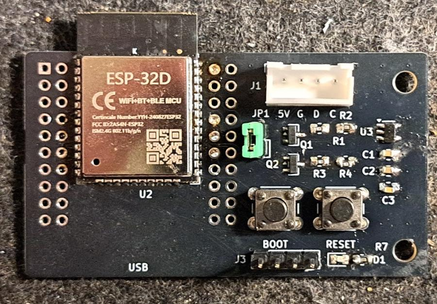
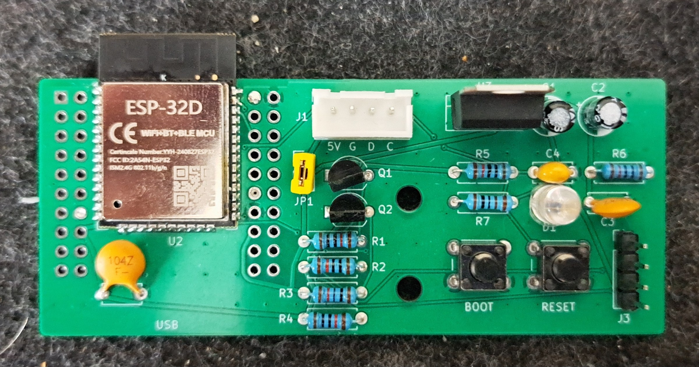
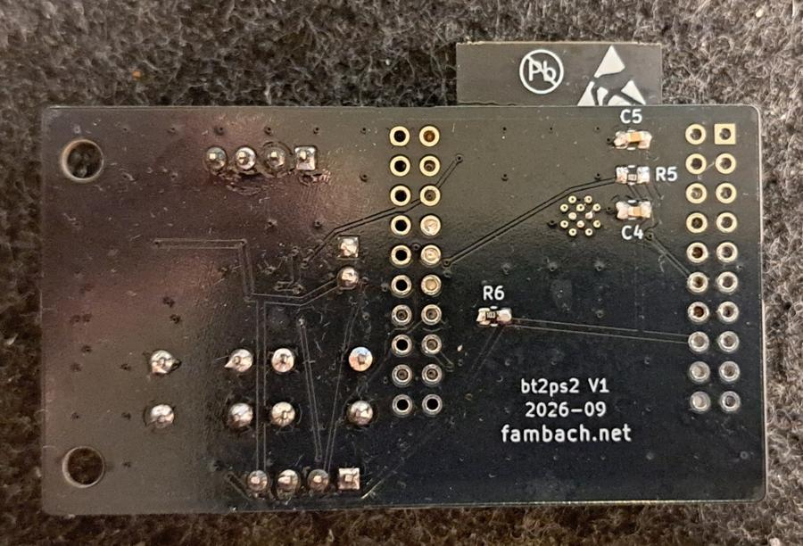
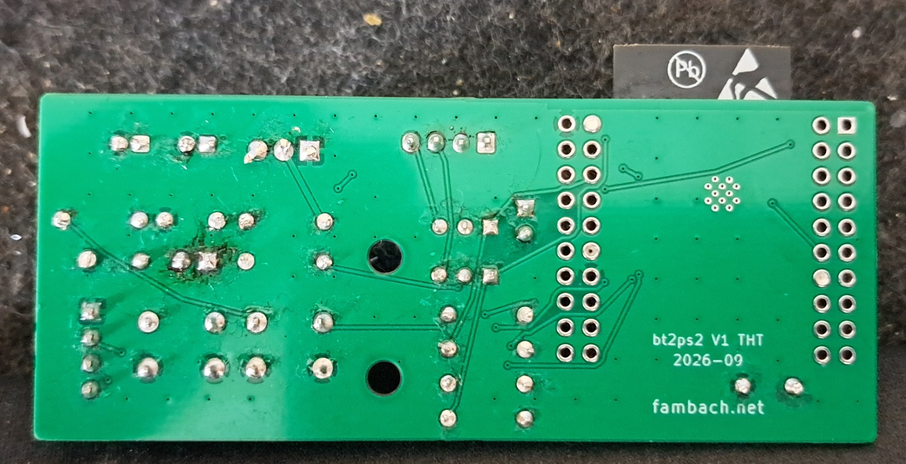
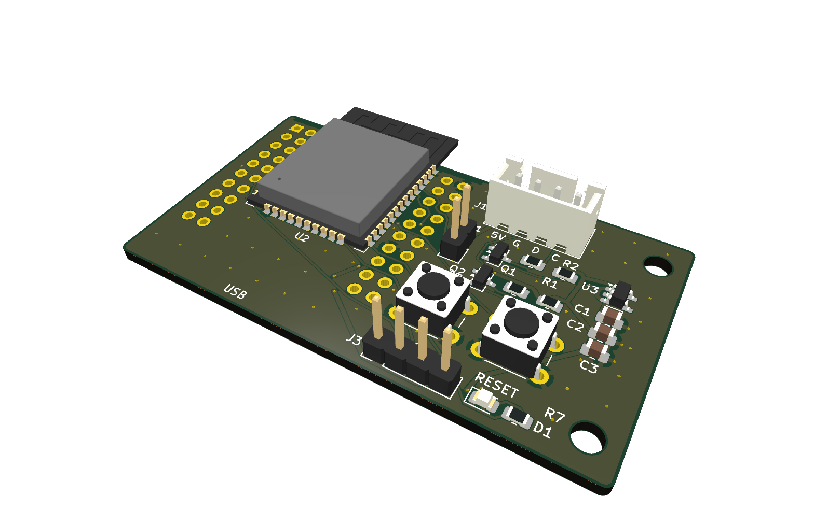
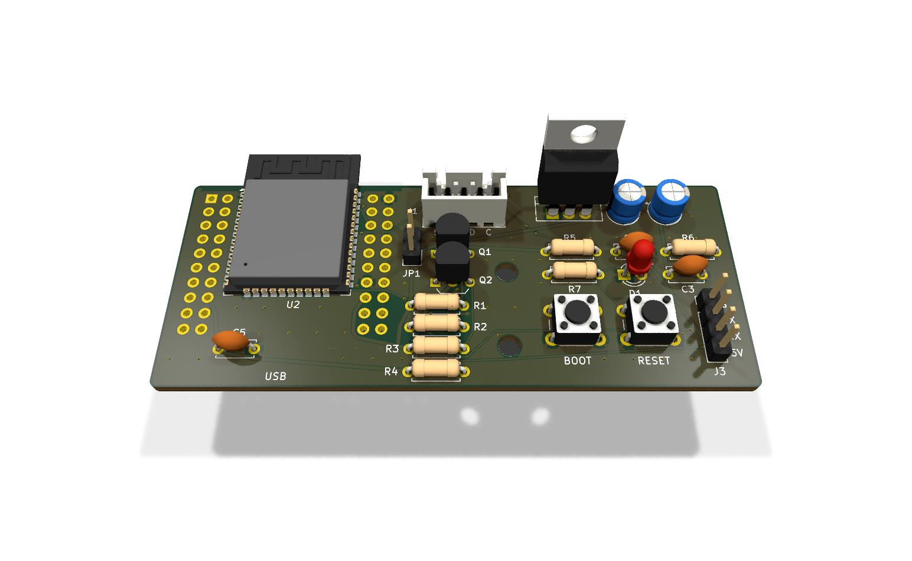
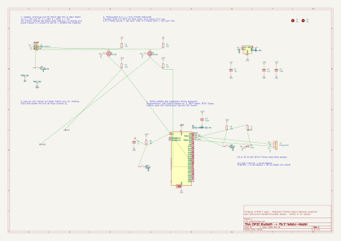
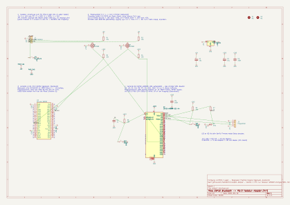

# Version 1 (built and tested)

Both V1 boards were manufactured by JLCPCB (2026-10) and run at the PC (tested with an RK-M75 keyboard over BLE,
also on a Micro 8088). Superseded by [version 2](../v2/README.md), which is not built yet.

| | [SMD](smd) | [THT](tht) |
|---|---|---|
| ESP32 | ESP32-WROOM-32E soldered on, or D1 mini ESP32 plugged in | **A:** D1 mini ESP32 plugged in, **or B:** ESP32-WROOM-32E soldered on |
| Level shifter | 2 × BSS138 + 10 kΩ | 2 × 2N7000 + 10 kΩ |
| 3.3 V regulator | AP2112K-3.3 | LD1117V33 (TO-220 standing, variant B only) |
| Programming | J3, 4 pins, BOOT/RESET by hand | A: USB of the D1 mini, B: J3, 4 pins, BOOT/RESET by hand |
| Size | 61.0 × 34.1 mm | 83.0 × 34.1 mm |

Populate **either** the D1 mini **or** the WROOM parts, never both (two 3.3 V regulators in parallel).

## Built boards

| SMD with ESP-32D | THT with ESP-32D (variant B) |
|---|---|
|  |  |
|  |  |

## KiCad

| SMD | THT |
|---|---|
|  |  |
|  |  |

Bills of materials: [SMD](smd/fertigung/stueckliste.csv), [THT](tht/fertigung/stueckliste.csv).
The files here carry small silkscreen fixes made after manufacturing (component references, J3 labels, LED `+`);
the Gerbers exactly as manufactured are on [release v0.1](https://github.com/sfambach/esp32-bt2ps2/releases/tag/v0.1).
Enclosures: [`../case/`](../case/README.md) (`tht` = V1 THT; the `smd` case is made for SMD V2).
