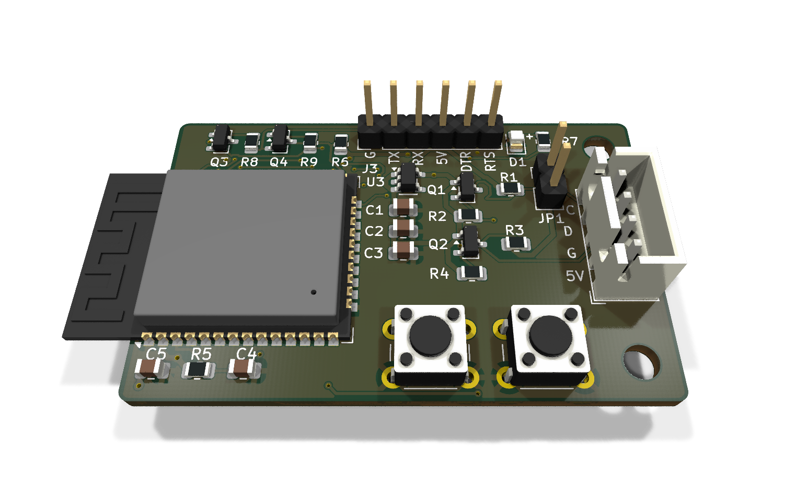
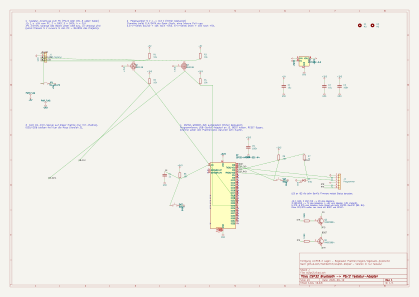
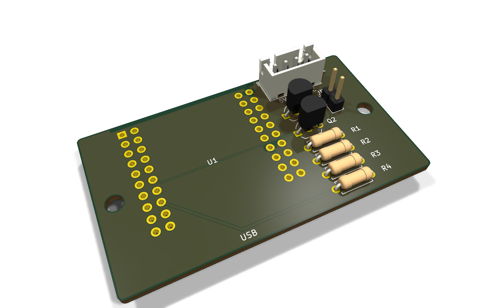
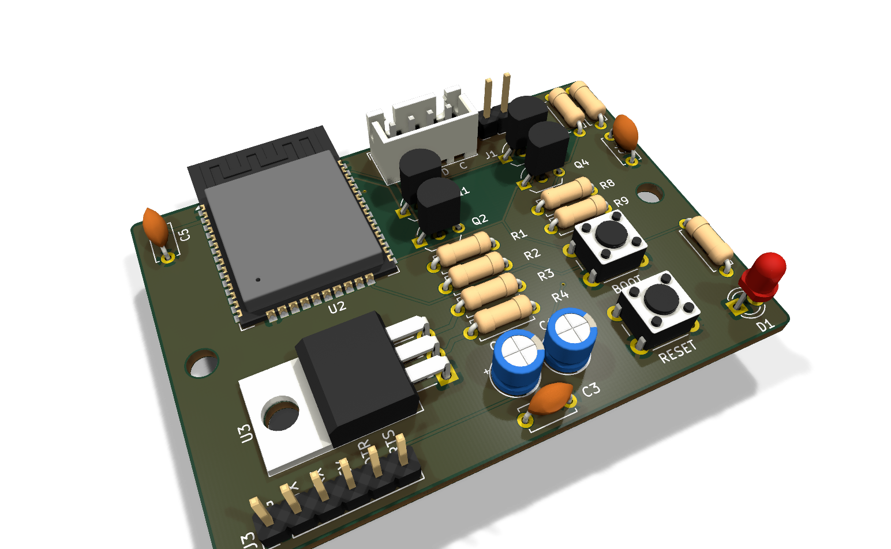
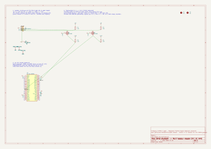
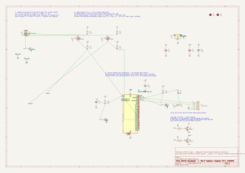

# Version 2 (current)

> ⚠️ **Not manufactured yet.** Designed and checked (ERC/DRC clean), routed with Freerouting. Replaces
> [version 1](../v1/README.md) once built and tested.

What changed against V1:
- **SMD (2026-10-31):** the D1 mini socket is gone, the WROOM is rotated 90° (antenna over the left edge), all parts
  are on the front, 49 × 31 mm instead of 61 × 34 mm. J3 has 6 pins with DTR/RTS auto-reset (Q3/Q4, MMBT3904).
- **THT (2026-11-01):** the combined board is split in two. **D1 mini:** socket, level shifter, J1/JP1 only
  (regulator, reset and BOOT are on the D1 mini). **WROOM:** the LD1117V33 lies flat (TO-220 horizontal, about
  4.5 mm instead of 15 mm high) and J3 has 6 pins with auto-reset (BC547). Two M3 holes on the long axis.
- LED anode marked with `+`, J3 pins labelled on the silkscreen.

## SMD

## THT

| D1 mini | WROOM |
|---|---|
|  |  |
|  |  |

Bills of materials: [SMD](smd/fertigung/stueckliste.csv), [THT D1 mini](tht-d1/fertigung/stueckliste.csv),
[THT WROOM](tht-wroom/fertigung/stueckliste.csv). Enclosures: [`../case/`](../case/README.md) (`smd`, `tht-d1`, `tht-wroom`).
